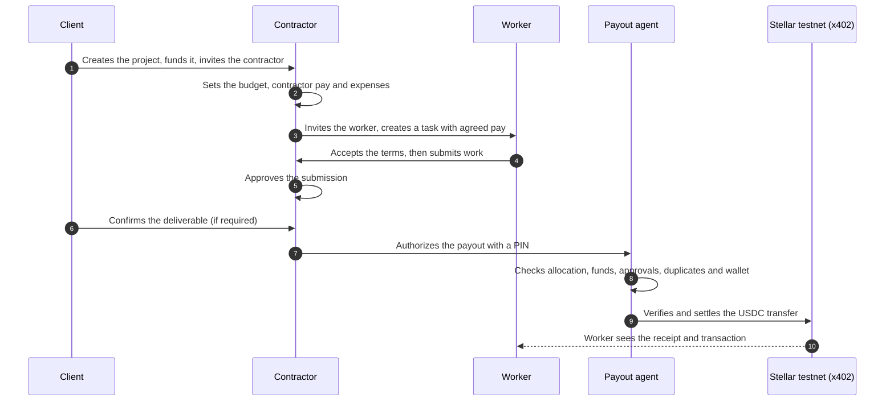
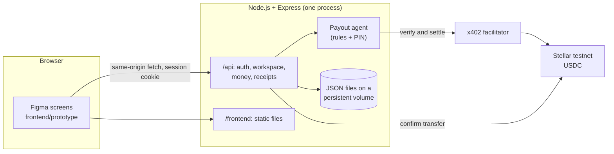

<div align="center">

# PayShare

**Fair, on-time pay for everyone on the project.**

PayShare records who is owed what, tracks the work, and pays each person automatically once the agreed approvals are in. It uses USDC on the Stellar testnet.

### 🔗 Live app: **[payshare.up.railway.app](https://payshare.up.railway.app)**

[](https://github.com/dahmeezy/PayShare/actions/workflows/ci.yml)
[](https://payshare.up.railway.app)


</div>

---

## Contents

1. [The problem](#the-problem)
2. [What PayShare does](#what-payshare-does)
3. [Roles and permissions](#roles-and-permissions)
4. [How a project flows](#how-a-project-flows)
5. [Screens and design](#screens-and-design)
6. [Architecture](#architecture)
7. [Tech stack](#tech-stack)
8. [Repository layout](#repository-layout)
9. [Run it locally](#run-it-locally)
10. [Five-minute demo](#five-minute-demo)
11. [Deployment (Railway, auto-deploy on push)](#deployment-railway-auto-deploy-on-push)
12. [Configuration reference](#configuration-reference)
13. [Payments: simulation and Stellar testnet](#payments-simulation-and-stellar-testnet)
14. [Testing](#testing)
15. [Security and privacy](#security-and-privacy)
16. [Known limits](#known-limits)
17. [Contributing](#contributing)
18. [Team](#team)

---

## The problem

On shared projects (an event, a build, a creative job) one person usually collects the money and pays everyone else. Workers chase payments, clients cannot see where their money went, and nobody agrees on what "done" means. PayShare gives the whole team one shared record of the budget, every task's agreed pay, who has approved what, and every payment.

## What PayShare does

| Area | What you get |
| --- | --- |
| **Projects and budget** | Create a project, set the budget, record contractor pay and expenses, and see what has been allocated to workers and what remains. |
| **Funding** | The client can fund a Stellar testnet project directly with Freighter. Simulation and advanced manual funding are also available. PayShare verifies the network, issuer, amount, source, destination and memo before updating the project. |
| **Verified sign-up** | First and last name, a password strength guide and agreement to the draft [Terms](frontend/legal/terms.html) and [Privacy Policy](frontend/legal/privacy.html). A 6-digit emailed code (10 minutes, 5 attempts, resend after 60 seconds) unlocks the account. |
| **Onboarding and tour** | Role (skipped for invited people), profile and notification choices, then straight to the dashboard with a short role-specific tour. |
| **Settings and notifications** | Profile, appearance, notification, security and wallet settings for every role, and an in-app notification feed built from project records. |
| **Invitations** | Private, single-use invitation links for workers, contractors and clients. The link sets the person's role on the server. |
| **Tasks with agreed terms** | Each task has a description, an allocation in USDC, and an optional client confirmation. The worker must **accept or decline the terms** before starting. |
| **Submissions and review** | Workers submit a note or link. Every version is kept. The contractor approves or requests changes, then the client confirms when the task requires it. |
| **Payout agent** | A rule-based agent checks every condition before money moves: allocation, available funds, approvals, duplicate prevention and the worker's wallet. It records each decision in plain language under **Agent activity**. |
| **Payout PIN** | The contractor creates a 6-digit PIN on the first payout and needs it for every payout after that. Repeated wrong entries lock it temporarily. |
| **x402 settlement** | Authorized payouts settle as USDC on the Stellar testnet through an x402 facilitator. A payout is marked paid only after the exact transfer is found on-chain. |
| **Receipts and transactions** | Each role sees receipts and a transaction history limited to what it is allowed to see. |
| **Dashboards** | Separate dashboards for clients, contractors and workers, with a light and dark theme. |
| **Responsive on every screen** | Full-width layouts from 360px phones to 2560px monitors. Phones use the Figma mobile frames and a bottom tab bar. |

## Roles and permissions

| | Client | Contractor | Worker |
| --- | :---: | :---: | :---: |
| Create a project, record funding | ✅ | ✅ | – |
| Set budget, expenses, contractor pay | – | ✅ | – |
| Invite people | ✅ (contractor) | ✅ (workers) | – |
| Create and assign tasks | – | ✅ | – |
| Accept or decline task terms | – | – | ✅ |
| Submit work | – | – | ✅ |
| Approve a submission | – | ✅ | – |
| Confirm a deliverable (when required) | ✅ | – | – |
| Authorize a payout (with PIN) | – | ✅ | – |
| See every worker's pay | ✅ | ✅ | ❌ only their own |

Every rule is enforced on the server (`backend/src/workspace-api.mjs`), not just hidden in the UI. Details are in [docs/PERMISSIONS.md](docs/PERMISSIONS.md).

## How a project flows



## Screens and design

The interface is built from the PayShare Figma file: **127 frames** covering desktop, mobile, 360px and dark-mode variants.

- **Desktop (≥ 768px):** the Figma desktop frames, stretched edge to edge with a sidebar. Layouts adapt between 768px and 1200px for tablets and small laptops.
- **Phone (< 768px):** the Figma phone frames (MC = contractor, MW = worker, MD = client). Screens designed only for desktop reflow to a single column and use the same bottom tab bar as the phone frames.
- **360px:** dedicated compact frames where Figma provides them.
- **Dark mode:** the authored dark frames, plus an adapted dark palette for every other screen.

The screen-by-screen map, with a link to each Figma node, is in [frontend/SCREENS.md](frontend/SCREENS.md). Reference screenshots are in [frontend/review](frontend/review).

## Architecture



- **One service:** the Express server serves both the API and the frontend, so there is no CORS and a single URL.
- **Storage:** users, the workspace and payout history are JSON files. When hosted, they live on a persistent volume.
- **Sessions:** HTTP-only, `SameSite=Strict` cookies. Cross-site writes are rejected by an Origin check.

## Tech stack

| Layer | Technology |
| --- | --- |
| Frontend | HTML, CSS, vanilla ES modules, generated from Figma frames. Inter and JetBrains Mono. |
| Backend | Node.js 22+, Express 4 |
| Payments | Stellar SDK, x402 (`@x402/express`, `@x402/stellar`), Circle testnet USDC |
| Optional AI | OpenAI summaries for project status (off by default; the scripted planner needs no key) |
| Tests | `node:test`, Supertest, Playwright (browser end to end) |
| CI | GitHub Actions: backend tests, navigation tests, attribution check |
| Hosting | Railway (auto-deploy from `main`, persistent volume, health check) |

## Repository layout

```text
PayShare/
├── backend/                 Express API, payout agent, storage, tests
│   ├── src/
│   │   ├── server.mjs           app entry: API + static frontend + /healthz
│   │   ├── workspace-api.mjs    projects, tasks, approvals, payouts, receipts
│   │   ├── auth-router.mjs      register, login, sessions, profile
│   │   ├── payout-agent.mjs     payout rules and the plain-language agent log
│   │   ├── payout-pin.mjs       contractor payout PIN
│   │   ├── stellar-settlement.mjs, workspace-settlement.mjs   x402 settlement
│   │   └── funding.mjs          testnet funding verification
│   ├── scripts/init-workspace.mjs   creates a new workspace history file
│   └── test/                    API, settlement and permission tests
├── frontend/
│   ├── prototype.html       app shell (served at /)
│   ├── prototype/           screen loader, live data layer, styles, Figma views
│   ├── ui/                  design tokens and shared components
│   └── test/mvp.cjs         three-role browser test (desktop and mobile)
├── docs/                    API contract, data model, permissions, status
├── railway.json             Railway build, start and health-check settings
├── render.yaml              alternative Render blueprint
└── package.json             root wrapper used by the host (build + start)
```

## Run it locally

You need **Git** and **Node.js 22 or newer**.

```bash
git clone https://github.com/dahmeezy/PayShare.git
cd PayShare
npm run build          # installs backend dependencies
npm start              # creates the workspace on first run, then starts the server
```

Open **http://localhost:4021**. No `.env` file, wallet or API key is needed for simulation mode.

On Windows PowerShell, use `npm.cmd` instead of `npm` if script execution is blocked.

Optional: enable the local commit guard once per clone:

```bash
git config core.hooksPath .githooks
```

## Five-minute demo

Use three browser profiles (or one normal window and two private windows), because each profile holds one signed-in account.

1. **Client:** register as a client, finish onboarding and choose **Fund a project**. Create a **Simulation** project with a 100 USDC budget and record 100 USDC of funding. Choose **Invite contractor** and copy the link.
2. **Contractor:** open the link in the second profile, register with the invited email and accept. Open **View budget**, then **Manage budget**: set compensation to 10 USDC and add a 5 USDC expense.
3. **Worker:** from the contractor dashboard choose **Invite worker**, open the link in the third profile and register. Add a public Stellar address in your profile.
4. **Task:** the contractor chooses **Create task**, assigns the worker, enters 45 USDC and ticks **Require client confirmation**. The worker opens **My tasks**, **accepts the terms**, then chooses **Submit work**.
5. **Approve and pay:** the contractor approves in **Review submissions**, and the client confirms in **Review & confirm**. The contractor opens **Approvals** and chooses **Authorize payout**. They create a 6-digit payout PIN the first time, or enter it later, then run the payout. The worker sees **Simulated · No funds moved** in **Payment history**, and **Agent activity** explains each check.

## Deployment (Railway, auto-deploy on push)

Production runs on Railway at **https://payshare.up.railway.app**. Every push or merge to `main` deploys automatically.

### How it is configured

| Setting | Value | Where |
| --- | --- | --- |
| Source | GitHub `dahmeezy/PayShare`, branch `main` | Railway service → Settings → Source |
| Build | `npm run build` (runs `npm ci` in `backend`) | `railway.json` |
| Start | `npm start` (initializes the workspace once, then starts the server) | `railway.json` |
| Health check | `GET /healthz` must return 200 before traffic switches | `railway.json` |
| Port | Railway injects `PORT`; the server listens on it | automatic |
| Storage | Volume mounted at `/data` | Railway service → Volumes |
| Domain | `payshare.up.railway.app` | Railway service → Networking |

### One-time setup (repository owner)

1. Sign in at [railway.com](https://railway.com) **with the GitHub account that owns the repository**, and install the **Railway GitHub app** for `dahmeezy/PayShare` when prompted (GitHub → Settings → Applications → Railway → repository access).
2. **New Project → Deploy from GitHub repo →** `dahmeezy/PayShare`. Railway reads `railway.json` automatically.
3. **Volumes → New volume**, mount path `/data`, size 1 GB.
4. **Variables:** add the values from the block below.
5. **Networking → Generate domain**, then rename it to `payshare` so the URL is `payshare.up.railway.app`.
6. Keep **one replica**. The JSON storage is single-writer.

After that, merging a pull request into `main` triggers a build. Railway waits for `/healthz` before switching traffic, so a broken build never replaces the live version.

### Railway variables

```ini
PAYSHARE_SECURE_COOKIES=true
PAYSHARE_USERS_FILE=/data/users.json
PAYSHARE_WORKSPACE_FILE=/data/payshare-workspace.json
PAYSHARE_STATE_FILE=/data/payshare-state.json
AGENT_SPEND_LOG_FILE=/data/.agent-spend-log.json
API_BASE_URL=https://payshare.up.railway.app
STELLAR_NETWORK=stellar:testnet
STELLAR_NETWORK_PASSPHRASE=Test SDF Network ; September 2015
STELLAR_HORIZON_URL=https://horizon-testnet.stellar.org
STELLAR_RPC_URL=https://soroban-testnet.stellar.org
STELLAR_EXPLORER_URL=https://stellar.expert/explorer/testnet
USDC_ASSET_CODE=USDC
USDC_ISSUER=GBBD47IF6LWK7P7MDEVSCWR7DPUWV3NY3DTQEVFL4NAT4AQH3ZLLFLA5
USDC_CONTRACT_ID=CBIELTK6YBZJU5UP2WWQEUCYKLPU6AUNZ2BQ4WWFEIE3USCIHMXQDAMA
USDC_DECIMALS=7
USDC_FAUCET_URL=https://faucet.circle.com
FACILITATOR=backup
FACILITATOR_BACKUP_URL=https://x402.org/facilitator
AGENT_PLANNER=scripted
# Only after the payer wallet is funded (see "Payments" below):
# PAYSHARE_ENABLE_TESTNET_PAYOUTS=true
# STELLAR_SECRET_KEY=S...        (set as a sealed variable, never commit)
```

### Backups

Back up `/data/users.json` and `/data/payshare-workspace.json` together, for example with a Railway volume backup. If history is damaged or missing, payouts stop safely until it is restored and reconciled.

## Configuration reference

| Variable | Default | Purpose |
| --- | --- | --- |
| `PORT` | `4021` | Port to listen on. Hosts set this automatically. |
| `PAYSHARE_USERS_FILE` | `backend/users.json` | Accounts and password hashes. |
| `PAYSHARE_WORKSPACE_FILE` | `backend/payshare-workspace.json` | Projects, tasks, approvals and payouts. |
| `PAYSHARE_SECURE_COOKIES` | `false` | Set `true` behind HTTPS. |
| `RESEND_API_KEY`, `EMAIL_FROM` | – | **Required for new sign-ups.** Resend API key and a sender on a verified domain (see below). |
| `EMAIL_API_URL` | `https://api.resend.com/emails` | Override only for a compatible provider or a test double. |
| `PAYSHARE_ENABLE_TESTNET_PAYOUTS` | `false` | Allows Stellar testnet projects once the payer and facilitator are configured. |
| `STELLAR_*`, `USDC_*` | – | Stellar testnet and Circle USDC settings (see above). |
| `STELLAR_SECRET_KEY` | – | Secret seed of the dedicated testnet payer. Server-side only. |
| `FACILITATOR`, `FACILITATOR_PRIMARY_URL`, `FACILITATOR_PRIMARY_API_KEY`, `FACILITATOR_BACKUP_URL` | – | Which x402 facilitator verifies and settles payments. |
| `AGENT_PLANNER` | `scripted` | `ai` enables optional OpenAI status summaries (`OPENAI_API_KEY`, `OPENAI_MODEL`). |

The full annotated list is in [backend/.env.example](backend/.env.example). Never commit `.env`, wallet seeds or the data files.

## Email verification setup

New accounts must confirm their email address. PayShare sends the code through the [Resend](https://resend.com) HTTP API.

1. Create a Resend account, then add and verify your sending domain (DNS records).
2. Create an API key with permission to send.
3. Set both variables on the server (locally in `backend/.env`, never committed):

```bash
RESEND_API_KEY=re_your_key
EMAIL_FROM="PayShare <no-reply@your-domain.com>"
```

4. Restart, sign up with an address you control and enter the code.

Without both values PayShare sends nothing, tells the person delivery is unavailable and keeps the new account locked. Resend's shared `onboarding@resend.dev` sender only delivers to the Resend account owner, so it is suitable for a first check only. Accounts created before verification existed keep working.

## Payments: simulation and Stellar testnet

- **Simulation projects** run the whole flow, including the agent checks, PIN and receipts, but move no money. Receipts say **Simulated · No funds moved**.
- **Stellar testnet projects:**
  1. The client opens **Fund project** in a browser with Freighter, switches Freighter to **Testnet**, and selects **Connect Freighter**. PayShare shows the connected public address and available testnet USDC. The client enters the amount, selects **Fund project**, and approves the transfer in Freighter. PayShare submits it and updates the project only after verifying it on Stellar. Connecting leaves the public address saved in the PayShare profile as it was.
  2. The worker saves a public Stellar account before the task is assigned.
  3. After every approval, the contractor authorizes the payout with the PIN. PayShare checks the budget and history, reserves one attempt, and asks the facilitator to verify and settle. It marks the payout **paid** only after finding the exact USDC transfer on-chain. If the result is uncertain, the payout stays locked until it is reconciled.

The client needs an activated testnet wallet, a Circle USDC trustline, test USDC and enough test XLM for the network fee. The project funding account also needs a Circle USDC trustline. [Freighter](https://freighter.app/) · [Circle testnet faucet](https://faucet.circle.com) · [Facilitator troubleshooting](backend/docs/troubleshooting.md)

If a wallet payment is pending, use **Check transaction status**. PayShare keeps the same transaction hash across refreshes and blocks a second funding attempt until Stellar confirms it or the ledger passes its expiry without recording it. An expired request, including one rejected for an outdated sequence number, can be prepared again with the latest account sequence.

If Freighter is unavailable, including on phones without a compatible wallet extension, open **Advanced manual funding** on the same screen. Save the sending wallet's public address in **Your profile** and send one classic testnet USDC payment to the address shown, using the displayed project hash memo. Enter the amount and transaction hash and select **Verify testnet deposit**.

## Testing

```bash
cd backend
npm test                                          # API, permissions, settlement, health
node --test ../frontend/prototype/*.test.mjs
```

Browser end to end, covering three roles on desktop and mobile:

```bash
cd backend
npm install --no-save --package-lock=false playwright
npx playwright install chromium
PLAYWRIGHT_MODULE="$(pwd)/node_modules/playwright" node ../frontend/test/mvp.cjs
PLAYWRIGHT_MODULE="$(pwd)/node_modules/playwright" PAYSHARE_MVP_MOBILE=1 node ../frontend/test/mvp.cjs
```

Browser regression checks (verification, settings, notifications, role limits, and every screen at 360–1440px in light and dark):

```bash
PLAYWRIGHT_MODULE="$(pwd)/node_modules/playwright" node ../frontend/test/regression.cjs
```

The browser tests use in-memory email, Freighter and Stellar testnet doubles. They require no service credentials or funded wallets. They cover all three roles, simulation and wallet funding, and the project flow through payout. They also check the dashboards for horizontal scrolling at 360, 390, 430, 768, 1024, 1440 and 1920px.

CI runs the backend and navigation tests and the attribution check on every pull request.

## Security and privacy

- Passwords and payout PINs are stored only as salted PBKDF2 hashes. Sessions use HTTP-only, `SameSite=Strict` cookies, plus `Secure` in production.
- Writes from another origin are rejected. Login, registration and recovery are rate limited.
- Invitation tokens are stored hashed and work once.
- Workers never receive other workers' pay or the contractor's compensation from the API.
- Wallet secrets stay on the server. Only public addresses are stored per user.
- Payouts need the contractor PIN, every approval, available funds and a clean payout history. Duplicate payouts are blocked.

## Known limits

- Email verification needs Resend (above). Password recovery, notification emails, WhatsApp, SMS and two-step sign-in are not available and are labelled that way. Invitation links are shared manually.
- Allocation changes, problem reports, voice notes, incomplete-task resolution and client budget approval are drawn in Figma but not built; their screens say so.
- English is the only supported language. The Terms and Privacy Policy are drafts pending team approval.
- Submissions store text or a link. File attachments and voice notes are not hosted.
- Other members' updates appear when you refresh or reopen a screen.
- Storage is single-instance JSON, so run one replica.

See [docs/STATUS.md](docs/STATUS.md) for the item-by-item status.

## Contributing

1. Branch from `main` (`feature/…`, `fix/…`, `chore/…`).
2. Run the tests above.
3. Open a pull request. A code owner must review it, and CI must pass.
4. Merge. Railway deploys `main` automatically.

Only the two team members below appear as authors or co-authors. CI rejects any other attribution ([docs/REPO_PROTECTION.md](docs/REPO_PROTECTION.md)).

## Team

| | Name | GitHub |
| --- | --- | --- |
| 👩🏾‍💻 | **Zainab Yusuf** | [@dahmeezy](https://github.com/dahmeezy) |
| 👩🏾‍💻 | **Maryam Qozeem** | [@maryam001-codes](https://github.com/maryam001-codes) |

## Acknowledgement

PayShare builds on the x402 Stellar EmpowerHer workshop starter kit by KoxyG.
